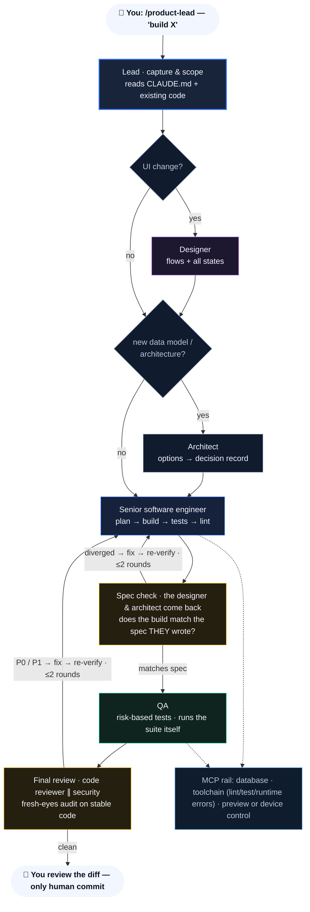

# AI Judgment Orchestration

**Ship like a team — with one command.** A judgment-driven orchestration of AI coding agents: one prompt becomes a reviewed, tested, security-audited change.

Built as [Claude Code](https://claude.com/claude-code) **skills** and **subagents**. Instead of you manually running the *implement → find bugs → review → fix → re-review* loop, a **product-lead** skill orchestrates a team of specialists and only comes back to you twice: to confirm scope, and to review the final diff. It's *judgment* orchestration because the lead makes the calls a script can't — skipping phases that don't apply, looping fixes back to the author, capping the loop at two rounds, and escalating to you.

I built this while building a production app solo; it let one person ship at the pace and quality of a small team. These templates don't assume any particular tech stack — adapt them to your project. Built for Claude Code, but the *pattern* runs on any agent harness ([see below](#works-beyond-claude-code)).

> **Star this repo** if it's useful — it helps other builders find it.

---

## The idea in one picture



A longer, annotated walkthrough lives in [`docs/orchestration.md`](docs/orchestration.md).

---

## What's inside

```
.claude/
  skills/      # the "job descriptions" — expertise + operating principles
  agents/      # thin subagent wrappers that load a skill and run in isolation
CLAUDE.md      # the context map every agent reads (the token-saver — see below)
docs/
  orchestration.md   # annotated diagram + how the pipeline runs
```

| Role | Skill | Subagent | What it does |
|---|---|---|---|
| **Product lead** | ✅ | — (runs in your main session) | Orchestrates the whole pipeline; owns scope + the human gate |
| **Senior software engineer** | ✅ | ✅ | Plans, implements, writes unit tests, runs the analyzer |
| **Code reviewer** | ✅ | ✅ | Adversarial diff review, severity-tagged (P0–P3) |
| **QA engineer** | ✅ | ✅ | Risk-based test plans + tests; runs them |
| **Security engineer** | ✅ | ✅ | Threat-models and audits; OWASP-severity findings |
| **Solutions architect** | ✅ | ✅ | Data-model / system decisions as ADRs |
| **UI/UX designer** | ✅ | ✅ | Flows, states, accessibility, design critique |
| **Legal / compliance** | ✅ | ✅ | Privacy, app-store, subscription-compliance review |
| **Marketing lead** | ✅ | ✅ | Listings, ASO, lifecycle copy, growth loops |
| **Business mentor** | ✅ | — | Strategy, pricing, unit economics, "am I building the right thing?" |

Skills carry the expertise; agents are thin wrappers that load a skill and run in an isolated context so the orchestrator's window stays clean. The product-lead and business-mentor are skills only — you run them in your main session, not as spawned workers.

---

## Two ideas that make it actually work

**1. `CLAUDE.md` is the token-saver.** Without a context map, every subagent re-reads your whole codebase just to orient itself — the same tokens, burned on every spawn. A thin root `CLAUDE.md` plus one per major area (loaded only when an agent touches that area) means each agent arrives already oriented. Context is a budget; spend it where it pays. The included [`CLAUDE.md`](CLAUDE.md) is a skeleton to fill in.

**2. The specialists who wrote the spec verify the build.** After the engineer implements, the **same** designer and architect who produced the spec come back to check the build against it — and bounce it back if it diverged. Then fresh-eyes code review + security run in parallel on stable code. Every fix loop caps at **2 rounds**, then escalates to you. Reviews that don't depend on each other run **concurrently** to cut wall-clock time.

---

## Quickstart

1. **Copy `.claude/` into your repo** (merge with an existing `.claude/` if you have one).
2. **Write your `CLAUDE.md`** using the included skeleton — this is the highest-leverage 30 minutes you'll spend. Map your repo, name your conventions and invariants, link area-specific `CLAUDE.md` files.
3. **Adapt the roles to your stack.** These templates are deliberately generic. Drop roles you don't need (no mobile app? trim the designer; pre-launch hobby project? skip legal). Rename the engineer if you want ("senior backend engineer," etc.). Add your stack's specifics to each skill — *specificity is what makes them sharp.*
4. **Run it.** In Claude Code, invoke the product lead and describe a feature:
   ```
   /product-lead  build a password-reset flow
   ```
   It scopes, delegates, reviews, and returns a diff for you to approve. Nothing commits without you.

You don't have to use the whole pipeline. Start with **one skill and one reviewer loop** (engineer + code-reviewer) and grow from there.

---

## Notes

- **These are templates, not a framework.** There's no install step and nothing to import — they're Markdown instructions Claude Code reads. Edit them freely.
- **Adapt before trusting.** The skills encode strong opinions (test what you touch, validate at boundaries, cap fix loops). Keep what fits your team; change what doesn't.
- **No support promised.** Shared as-is under MIT. Issues and PRs are welcome but may not get a fast response.

---

## Works beyond Claude Code

These are Claude Code skills and subagents — they use Claude Code's `.claude/skills` + `.claude/agents` format and its subagent/MCP model. But the **pattern is harness-agnostic**:

- **Skills** are role prompts — expertise + operating principles.
- **Agents** are thin role wrappers that run in an isolated context.
- **product-lead** is the orchestration playbook that drives the pipeline.
- **CLAUDE.md** is the shared context map that keeps every role oriented cheaply.

To run this on another agent runner (Cursor, Codex, your own loop), keep the Markdown and adapt the wiring to that tool's mechanism for system prompts and tool/subagent invocation. The judgment — phase-skipping, the spec-authors-verify loop, the 2-round fix cap, the human gate — carries over unchanged. What's Claude Code-specific is the plumbing, not the thinking.

---

## Who made this

Built by **Abid Waqar** — senior engineer / solutions architect — while building [Gryter](https://gryter.com), an AI fitness coach, solo. If this is useful, connect on [LinkedIn](https://www.linkedin.com/in/abidwaqar/) and I'll share what I learn next. If you train, [Gryter](https://gryter.com) is worth a look.

## License

[MIT](LICENSE) — do whatever you want, no warranty.
