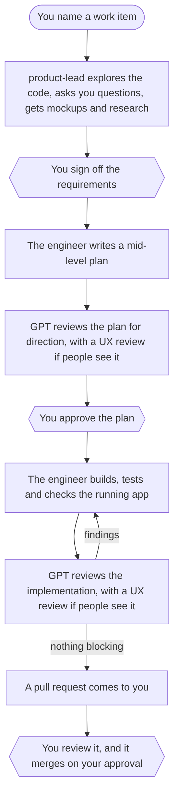

<!-- Adapted from the orchestration behind Gryter (gryter.com), an AI fitness coach built by one engineer. -->
# AI Judgment Orchestration

A starter of the orchestration one engineer uses to ship like a team of 50 with AI, built from thirteen mistakes.

It's a set of [Claude Code](https://claude.com/claude-code) skills and agents you copy into your own project. They don't write your product for you. They give the work a shape: you decide what gets built and whether it's right, and the AI does the rest in between, checked by a reviewer that doesn't share its blind spots.

## The idea

- **Three decisions stay with you:** the requirements, the plan, and the result. Everything between them is the AI's job.
- **Plans are mid-level, and reviewed for direction.** Approach, parts, data, what can fail and how it's tested, with no line-by-line steps. A wrong direction is cheap to catch on a page and expensive to catch in code.
- **The reviewer comes from another AI family.** Claude builds; a GPT model reviews, through the Codex CLI, in a fresh session every round. A reviewer that shares the author's assumptions shares its mistakes.
- **The AI sees the running app.** Tests aren't the whole story. The engineer looks at what it built, on an emulator, in a browser or through the API, before anyone calls it done.
- **Two leads split the work.** The product lead settles requirements with you before a branch exists. The delivery lead runs everything after that.

## What's inside

| Kind | Name | What it does |
|---|---|---|
| Skill | `product-lead` | Settles one work item's requirements with you: explores the code, asks only what's yours to decide, gets mockups drawn for new UI, and writes signed-off requirements where your project keeps them. |
| Skill | `delivery-lead` | Takes one settled item to a merged pull request: plan, independent review, your approval, build, review again, your review of the pull request. |
| Skill | `software-engineer` | The engineering standard: mid-level plans, tests that fail when the behavior is wrong, honest verification, and checking the running app. |
| Skill | `ui-ux-designer` | The design method and rules: who, job and moment; hierarchy, states, flows and words. Your tokens and voice go in slots. |
| Skill | `solutions-architect` | Structural decisions: data models, services, cost and migrations, written as decision records. |
| Skill | `adapt-to-your-project` | Run once after copying. Fills every slot with your project's facts and removes what doesn't apply. |
| Agent | `software-engineer` | The engineer the delivery lead spawns and keeps warm for the whole item, from plan to last repair. |
| Agent | `delivery-reviewer` | A Claude fallback reviewer, used only when you choose it. Every verdict it gives is marked NOT INDEPENDENT. |
| Agent | `ui-ux-designer` | Draws mockups, reviews screens and screenshots, and stands in as the UX reviewer when you choose it. |
| Agent | `web-researcher` | Researches outside the repository, with no access to it, so its findings aren't anchored to how you do things now. |

The reviewers' rulebooks, with their output contracts and severity scales, are in `.claude/skills/product-lead/references/` (`review.md` and `ux-review.md`). The GPT model and effort every Codex run uses are in one file, `.claude/skills/product-lead/scripts/gpt-model.sh`.

## Quick start

1. **Copy `.claude/` into your project's root.** If you already have a `.claude/` folder, merge them.
2. **Install the Codex CLI if you want independent reviews:** `npm install -g @openai/codex`, then `codex login`. Without it, reviews run on Claude, and every verdict says it isn't independent.
3. **Run the setup skill.** In Claude Code, in your project, type `/adapt-to-your-project`. It reads your project, asks a few questions it can't answer from the code, fills in the slots, and adds a short "How we work" section to your `CLAUDE.md`.
4. **Start with one item.** `/product-lead <your first work item>` settles it with you; `/delivery-lead <the item>` builds it.

## How a feature flows

1. You name a work item, and the product lead says in plain words what it is.
2. An explorer reads the code, so the questions you get are about real choices, not things the code can answer.
3. You settle the scope, the behavior and the states. New UI gets mockups first.
4. You sign off the requirements, and they're written where your project keeps them.
5. The delivery lead branches, and the engineer writes a mid-level plan.
6. A GPT reviewer reviews the plan, once, or twice if the repair changed direction.
7. You approve the plan.
8. The engineer builds it, tests it, and looks at it running.
9. The reviewer reviews the implementation, and the engineer repairs, until another round wouldn't change what ships.
10. A pull request comes to you. You review it, and it merges once you say it's approved.

The longer walk-through, with the reasoning behind each rule, is in [`docs/orchestration.md`](docs/orchestration.md).

## Requirements

- [Claude Code](https://claude.com/claude-code).
- The [Codex CLI](https://github.com/openai/codex), logged in, for independent reviews.
- The [GitHub CLI](https://cli.github.com/) (`gh`), if you keep work items in GitHub issues and use pull requests. That's the default, and the setup skill can point it elsewhere.

## Credit and licence

Adapted from the orchestration behind Gryter (gryter.com), an AI fitness coach built by one engineer.

MIT. See [LICENSE](LICENSE).

Want help setting this up for your team? Reach out via https://github.com/abidwaqar.
