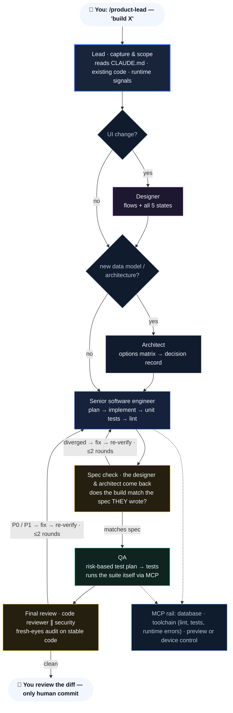

# The orchestration, annotated

One command in. A reviewed, tested change out. The `product-lead` skill runs this pipeline; you appear twice — to ask, and to review the final diff.

## Reading it in one breath

- **The two white nodes are you.** You confirm scope at the start and review the diff at the end. Everything between is agents.
- **Diamonds are the lead's judgment calls.** Phases get *skipped* when they'd add nothing — a backend-only change skips the designer; a copy tweak skips almost everything. Right-sizing is the point, not running all eight phases mechanically.
- **The two amber boxes are review passes.** The first is the **designer & architect coming back to check the build against the spec they wrote** — spec drift caught before QA wastes effort. The second is fresh-eyes code review + security on stable code.
- **Each amber box loops back to the engineer** if it finds P0/P1 problems — capped at **2 rounds**, then it escalates to you instead of grinding forever.
- **The dotted rail is how agents touch the real world.** Wire MCP tools to your stack — your database, your lint/test toolchain, a preview server or device — and the engineer and QA can verify their own work instead of guessing.

## Why this order

1. **Scope before spawning.** The lead mines your `CLAUDE.md` and existing code first, so specialists start oriented (and cheap).
2. **Design/architecture before code**, but only when the change warrants it.
3. **Spec-compliance review before QA**, so tests are written against a target that won't shift under them.
4. **Code review + security last**, on stable code, so the audit reflects what actually ships.
5. **Human gate always.** No agent commits. You review the diff.

## Right-sizing

| Change type | Phases that typically run |
|---|---|
| Copy / one-line tweak | engineer → code review |
| New screen / component | designer → engineer → spec check → light QA → code review |
| Feature with backend work | the full pipeline |
| Auth / payments / data-integrity | full pipeline + mandatory security + heavier QA |
| Refactor | architect (if structural) → engineer → regression-focused QA → code review |

The orchestrator decides per task. The goal is to invoke a phase only when its specialist would catch something the others wouldn't.
